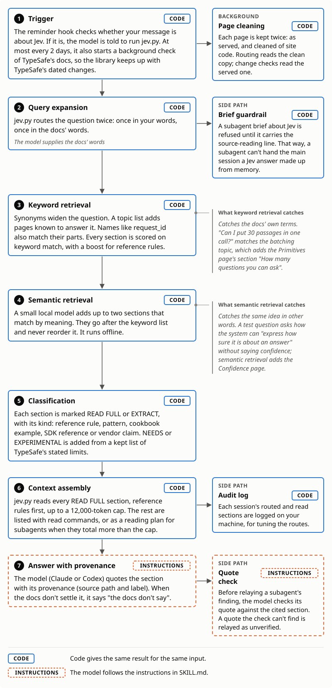

# Jev Sources

Hate when your coding harness hallucinates Jev functionality or implements Jev from memory? Want to avoid a research agent getting called every session? Jev Sources puts the relevant TypeSafe documentation sections in your coding harness's context when you develop with Jev.

It answers Jev questions from TypeSafe's official docs, cookbooks, patterns and blog posts. It never calls Jev: your coding agent's Claude or Codex model does the reading, so no TypeSafe key is needed. It finds sections by keyword and by meaning (a small offline model), reads the key ones in full and labels each, so rules and examples aren't confused.

For developers and agent teams checking Jev designs.

## Sample

> **jev.py** on "can I put 30 passages in one call?", trimmed
> ### Reference rules read first
>
> - `CITE AS: docs/primitives.md#How many questions you can ask (reference rule)` "There is no limit on the number of questions in a request. What limits a request is its size: ..."
> - `CITE AS: cookbooks/parallel_questions.md#Parallel questions (cookbook example)`
>
> **Next:** the model quotes the reference rule.

## Labels

`jev.py` labels every section it finds, telling the model how to use it.

| Label | The model | Set when |
|---|---|---|
| **READ&nbsp;FULL** | Reads it all before any claim | Short, or the question limits a design |
| **EXTRACT** | Gets a pointer; claims from it are unverified | Long, or matched by meaning only |
| **NEEDS** | Names the model the section needs; reads it last when you named an older one | The page needs a newer model than yours (or than jev-latest), per a kept list of TypeSafe's stated limits |
| **EXPERIMENTAL** | Quotes TypeSafe's line that it isn't production-ready | TypeSafe calls it experimental (same list) |

## How it works

<picture>
  <source media="(prefers-color-scheme: dark)" srcset="images/how-it-works-dark.svg">
  
</picture>

1. A hook sees a Jev message and tells the model to run `jev.py`. At most every two days it also starts a background check, so the library keeps up with TypeSafe's dated changes.
2. `jev.py` routes your words and the docs' words: keywords rank sections, boosting reference rules, and the local model adds up to two. It reads the READ FULL ones, reference rules first, up to a size cap.
3. The model quotes each section with its provenance (source and label), or says "the docs don't say".

| Step | Who enforces it |
|---|---|
| Routing, labels, reading order, cap | Code, once the model runs `jev.py` |
| Reminder; refusing a Jev brief without its source line | Hooks, once installed |
| Running `jev.py`, the quote, its provenance | The model, following `SKILL.md` |

The check fetches new and re-dated pages, archives old copies and, after a change, reruns the routing tests and lists stale citations. Data stays in `~/.claude/jev-sources-data/`; `JEV_LOG=off` stops the question log.

## What it reads

It reads TypeSafe's docs (including Models and the API and SDK reference), patterns, cookbooks and blog posts (labeled vendor claims). The refresh finds them through the sitemaps, the docs' `llms.txt` and `scripts/urls.txt`. `SOURCES.md` in the data folder lists every page your copy holds and when it was saved. Updated for Jev 1.14, including image input and Box questions, both experimental per TypeSafe.

## Where the rules come from

Jev Sources adds no rules. It quotes TypeSafe and labels each page's kind: reference pages say what the API allows; cookbooks show one working build. So a cookbook that sends one request per item shows one way to build it; a reference page or the cookbook's scope note says whether you must. Rating a design is a separate skill, [Jevaluate](../jevaluate/).

## How accurate it is

Tests rerun after each docs change. Scores are in-sample (routes were tuned on these questions; no held-out set), so expect lower recall on new questions.

| Test | Result |
|---|---|
| 20 questions in everyday words | 16 find their section (14 on keywords alone) |
| 20 release-check questions | All 20 read in full (11 on keywords before new routes) |
| 3 questions naming an older model | All labeled right |

The table measures what `jev.py` finds once the model runs it. Whether the model runs it at all depends on the reminder hook. If the reminder misses a Jev question, the model may answer without the docs. The reminder's rule was tuned on labeled real prompts. `scripts/firing_report.py` shows how often it fires now.

## Install and use

Needs Claude Code or Codex, git and Python 3.8+. Meaning matching needs model2vec, installed by the first refresh.

Claude Code plugin, with hooks:

```
claude plugin marketplace add tiffygk/jev-mode
claude plugin install jev-sources@jev-mode
```

Codex plugin:

```
codex plugin marketplace add tiffygk/jev-mode
codex plugin add jev-sources@jev-mode
```

Then ask your agent to refresh. By copy (Codex: `~/.agents/skills/` throughout):

```
git clone https://github.com/tiffygk/jev-mode
cp -r jev-mode/jev-sources ~/.claude/skills/
bash ~/.claude/skills/jev-sources/refresh.sh --fetch
python3 ~/.claude/skills/jev-sources/scripts/jev.py "can I put 30 passages in one call?"
```

Copy installs add hooks by hand: [`hooks/install-hooks.md`](hooks/install-hooks.md).

## Limits

A page TypeSafe edits without updating its sitemap date stays stale until a full refresh (`refresh.sh --fetch`). A question worded unlike the docs can miss its section. Not affiliated with TypeSafe.

## License

PolyForm Noncommercial 1.0.0: free for personal and noncommercial use, with credit. Company or paid use needs a commercial license: [open an issue](https://github.com/tiffygk/jev-mode/issues).
