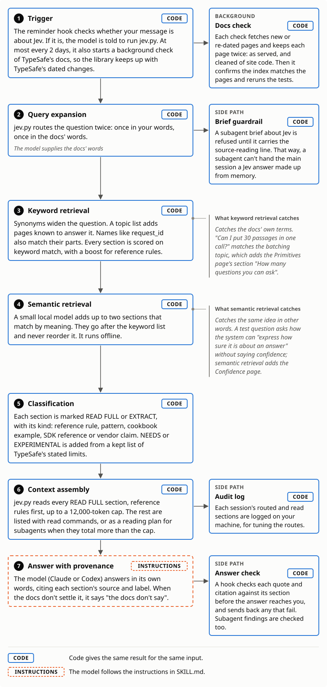

# Jev Sources

Hate when your coding harness hallucinates Jev functionality or implements Jev from memory? Want to avoid a research agent getting called every session? Jev Sources (updated for 1.14) matches your question by keywords and meaning. Only the most relevant TypeSafe documentation sections land in your coding harness's context.

It answers Jev questions from TypeSafe's official docs, cookbooks, patterns and blog posts. It never calls Jev: your coding agent's Claude or Codex model does the reading, so no TypeSafe key is needed.

## Sample

> **jev.py** on "can I put 30 passages in one call?", trimmed
> ### How many questions you can ask
>
> - `CITE AS: docs/primitives.md#How many questions you can ask (reference rule)` "There is no limit on the number of questions in a request."
> - `CITE AS: cookbooks/parallel_questions.md#Parallel questions (cookbook example)`

## Labels

Each section `jev.py` finds gets a label:

| Label | The model | Set when |
|---|---|---|
| **READ&nbsp;FULL** | Reads it all before any claim | Short, or the question limits a design |
| **EXTRACT** | Gets a pointer; claims from it are unverified | Long, or matched by meaning only |
| **NEEDS** | Names the model the section needs; reads it last when you named an older one | The page needs a newer model than yours (or than jev-latest), per a list of TypeSafe's stated limits |
| **EXPERIMENTAL** | Quotes TypeSafe's line that it isn't production-ready | TypeSafe calls it experimental (same list) |

## How it works

<picture>
  <source media="(prefers-color-scheme: dark)" srcset="images/how-it-works-dark.svg">
  
</picture>

1. A hook sees a Jev message and tells the model to run `jev.py`.
2. `jev.py` matches your question to the docs two ways, then reads the best matches:
   - Keywords rank sections and boost reference rules; names like `request_id` also match their parts.
   - A small offline model compares meanings and adds up to two sections the keywords missed.
   - Both read the docs without the site's display code stuffing context.
   - `jev.py` reads the READ FULL sections, reference rules first, up to a size cap. The model reads small leftovers itself; past a third of the cap, subagents read the rest.
   - A question reads what it asks. A build request runs one question per part and names any that found nothing.
3. The model answers in its own words, citing each section and label, or says "the docs don't say". A hook sends back misquotes and citations to missing sections.

| Step | Who enforces it |
|---|---|
| Routing, labels, reading order, cap | Code, once the model runs `jev.py` |
| Reminder; refusing subagent instructions without their source line; checking citations, a subagent's or the answer's | Hooks, once installed |
| Running `jev.py`, the answer, its sources | The model, following `SKILL.md` |

Data stays in `~/.claude/jev-sources-data/`; `JEV_LOG=off` stops logging your questions.

## How it stays current

With the hooks installed, your first Jev message after two days starts a background check for new or re-dated TypeSafe pages. A later message names any changes. If no check finishes in seven days, the model tells you to run the refresh command. Without the hooks, run `refresh.sh --fetch` yourself.

Each check confirms the index matches the saved pages and flags any mismatch or broken page. After a page changes, it also reruns the routing tests and lists the citations it affects. With pytest installed, it runs the library tests; `JEV_LIBRARY_TESTS=off` skips them.

## What it reads

It reads TypeSafe's docs (including Models and the API and SDK reference), patterns, cookbooks and blog posts (labeled vendor claims). `SOURCES.md` in the data folder lists every page your copy holds and when it was saved. Updated for Jev 1.14, including image input and Box questions, both experimental per TypeSafe.

## Where the rules come from

Jev Sources adds no rules. It cites TypeSafe and says each page's kind: reference pages say what the API allows; cookbooks show one working build. A cookbook that sends one request per item shows one way to build it; a reference page or its scope note says whether you must. Rating a design is a separate skill, [Jevaluate](../jevaluate/).

## How accurate it is

| Questions | n | Difficulty | Counts as found when the section is | Found (recall), with 95% confidence interval |
|---|---|---|---|---|
| Everyday questions | 21 | 🟢 Easy | listed, at any label | 95% (20 of 21; 77% to 99%) |
| Everyday questions | 21 | 🟢 Easy | printed in full within the cap | 90% (19 of 21; 71% to 97%) |
| Release-check questions | 23 | 🟢 Easy | printed in full within the cap | 100% (23 of 23; 86% to 100%) |
| New questions, blinded | 11 | 🟡 Medium | marked READ FULL | 64% (7 of 11; 35% to 85%) |
| New questions, blinded | 11 | 🟡 Medium | on the same page as the answer | 91% (10 of 11; 62% to 98%) |
| SDK questions, blinded | 24 | 🔴 Hard | printed in full within the cap | 42% (10 of 24; 24% to 61%) |
| Broad first-time goals, blinded | 12 | 🔴 Hard | read or left for later reading | 49% of needed sections (40% to 60%); unsplit, 9% |

How to read it:
- 🟢 **Easy** questions cover the docs broadly; the routing was tuned on them.
- 🟡 **Medium** questions cover the same ground, but the routing never saw them. Expect these numbers on new questions.
- 🔴 **Hard** questions each ask about one function, field or error in the SDK reference.
- **Listed** means the section is anywhere in the list `jev.py` returns. **Printed in full** is stricter: the whole section, within the cap.
- **Found** is recall: the share of questions whose section was found. For goals, it is the average share of each goal's needed sections, as a separate reviewer marked them. Ranges are 95% confidence intervals (Wilson; bootstrap for goals), wide on small rows.
- **Broad goals** are first-time requests, such as moving a classifier to Jev, blinded. Splitting reads about 4 times the tokens.

The table measures `jev.py` once it runs; `scripts/firing_report.py` shows how often the reminder hook prompts it. Live sessions in projects that say they use Jev met blind answer keys on 18 of 19 tests, twice, and 10 of 11 held out.

## Install and use

Needs Claude Code or Codex, git and Python 3.8+. Meaning matching needs model2vec, installed by the first refresh.

Claude Code plugin, with hooks:

```
claude plugin marketplace add tiffygk/jev-mode
claude plugin install jev-sources@jev-mode
```

Codex plugin:

```
codex plugin marketplace add tiffygk/jev-mode
codex plugin add jev-sources@jev-mode
```

Then ask your agent to refresh. Codex runs no plugin hooks: have it run `scripts/codex_hooks.py install`. By copy (Codex: `~/.agents/skills/` throughout):

```
git clone https://github.com/tiffygk/jev-mode
mkdir -p ~/.claude/skills
cp -r jev-mode/jev-sources ~/.claude/skills/
bash ~/.claude/skills/jev-sources/refresh.sh --fetch
python3 ~/.claude/skills/jev-sources/scripts/jev.py "can I put 30 passages in one call?"
```

Copy installs add hooks by hand: [`hooks/install-hooks.md`](hooks/install-hooks.md).

To install every jev-mode skill at once, or to copy skills by hand, see the [repo README](../README.md#install).

## Limits

A page TypeSafe edits without updating its sitemap date stays stale until a full refresh (`refresh.sh --fetch`). A question worded unlike the docs can miss its section. Not affiliated with TypeSafe.

## License

PolyForm Noncommercial 1.0.0: free for personal and noncommercial use, with credit. Company or paid use needs a commercial license: [open an issue](https://github.com/tiffygk/jev-mode/issues).
