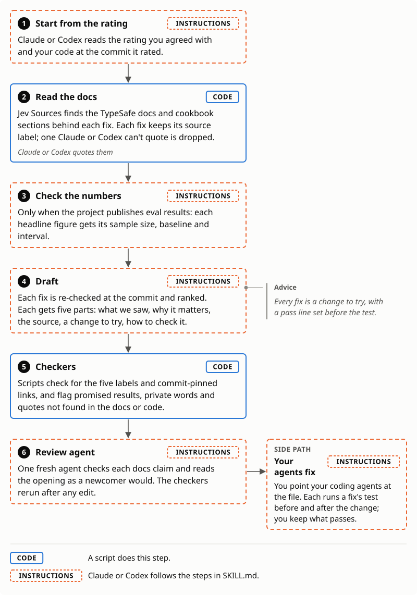

# Jevaluate Report

Turn your Jevaluation of your Jev projects into a report you can feed directly to your agents to loop on and incorporate best practices!

[Jevaluate-privately](../jevaluate-private/) gives your Jev project a rating against TypeSafe's docs that stays on your machine. Tune that rating to your own product judgment before creating the report. Once the rating is right, this skill turns it into a Markdown file of fixes that are checked by a review agent. Your coding agents work through them before a pull request.

Each fix rests on TypeSafe's documented practice and is advice to test on your own eval. It never calls Jev, so it needs no TypeSafe key, and never publishes your rating to this repo's [ratings](../ratings/).

## When to use it

| Situation | Do |
|---|---|
| You built with [Jev Sources](../jev-sources/) and rated with [Jevaluate-privately](../jevaluate-private/) | Read the rating; correct any call you disagree with |
| You agree with the rating | `jevaluate-report`, then point your agent at the file |
| Your agents finished the fixes | Rate again; rerun the report if problems remain |

## Who it's for

- Developers and teams building with Jev.
- Anyone about to commit Jev code who wants it checked against TypeSafe's best practices: Execution, Fit, Coverage and Evidence, scored for its type and stakes.

## Sample

> Part of one fix from the [skimmer](https://github.com/dorkitude/skimmer/issues/3) report (October 2026), rewritten in this format:
>
> ### S7: Hold out goals the settings never saw
>
> **Suggested change.** Try splitting goals into a development set and a held-out set before the next round of choices, by document so that no document is in both. Tune the threshold, chunk size and prompt on development goals only, and report the held-out numbers once.
>
> **How to check it.** The held-out recall and kept-chunk figures at the chosen settings, beside the development figures.

## What the report holds

Each fix has five parts:

| Each fix has | What it holds | Who acts on it |
|---|---|---|
| **What&nbsp;we&nbsp;saw** | The code line it rests on, linked at the rated commit | Your agent |
| **Why&nbsp;it&nbsp;matters** | What the problem may cost your product | You, the developers, decide whether to accept the fix and test it |
| **Source** | The TypeSafe docs quote behind it | Your agent |
| **Suggested&nbsp;change** | A change to try | Your agent |
| **How&nbsp;to&nbsp;check&nbsp;it** | A test and its pass line, set before the run | Your agent |

## How it works

1. Read the rating and your code at the commit it rated.
2. Read the TypeSafe docs behind each fix through [Jev Sources](../jev-sources/).
3. Check any published eval numbers.
4. Re-check and rank the fixes, then draft from the template.
5. Run the format and quote checkers, then one review agent.
6. Rerun the checkers after any edit and hand back the file.

Between runs it keeps only `lessons.md`, notes on what past reports taught; only a pull request changes them.

<picture><source media="(prefers-color-scheme: dark)" srcset="images/how-it-works-dark.svg"></picture>

## Where the rules come from

Verdicts and scores come from the [Jevaluate rubric](../jevaluate/rubric.md); the layout from the skimmer report, whose maintainer adopted 14 of 16 fixes.

## Why code checks the file

- A report promised a 4 the fix's test disproved, so promises are flagged.
- A quote didn't match the code it linked, so every quote is checked against its link.

## How accurate it is

The format checker got 31 of 31 blind test files right, 11 held out from its development; the quote checker, 24 of 24. Neither tests whether a fix helps you; each fix's own test does.

## Install and use

Needs Claude Code or Codex, git and Python 3.9+. In Claude Code:

```
claude plugin marketplace add tiffygk/jev-mode
claude plugin install jevaluate-report@jev-mode
claude plugin install jevaluate-private@jev-mode
claude plugin install jev-sources@jev-mode
```

In Codex:

```
codex plugin marketplace add tiffygk/jev-mode
codex plugin add jevaluate-report@jev-mode
codex plugin add jevaluate-private@jev-mode
codex plugin add jev-sources@jev-mode
```

Then ask your agent to refresh Jev Sources once, which downloads TypeSafe's docs. To install every jev-mode skill at once, or to copy skills by hand, see the [repo README](../README.md#install).

## Limits

It never commits, posts or opens a pull request. Not affiliated with TypeSafe.

## License

PolyForm Noncommercial 1.0.0: free for personal and noncommercial use, with credit. Company or paid use needs a commercial license: [open an issue](https://github.com/tiffygk/jev-mode/issues).
