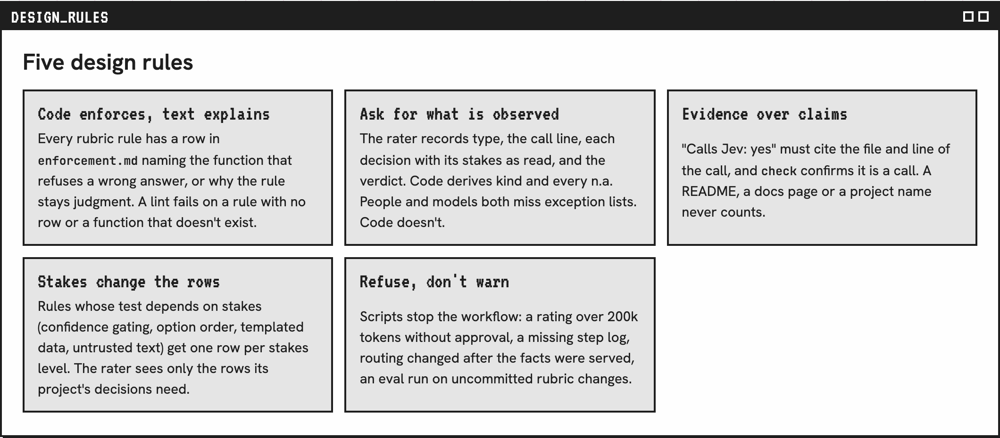
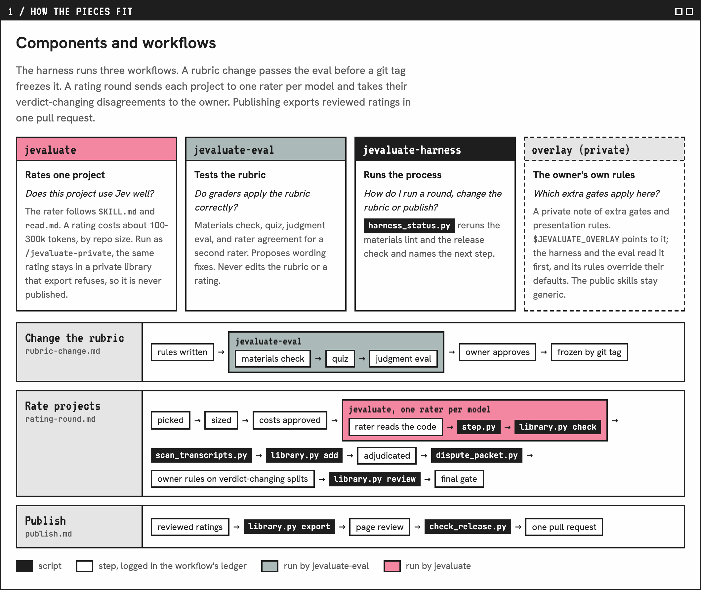
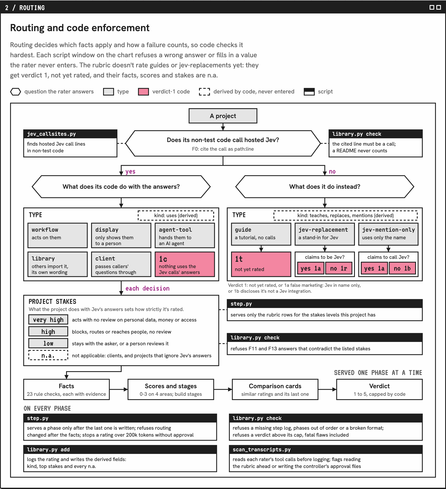
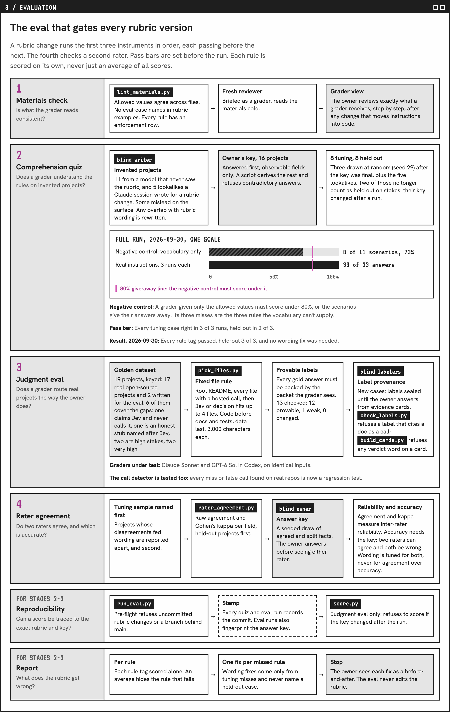
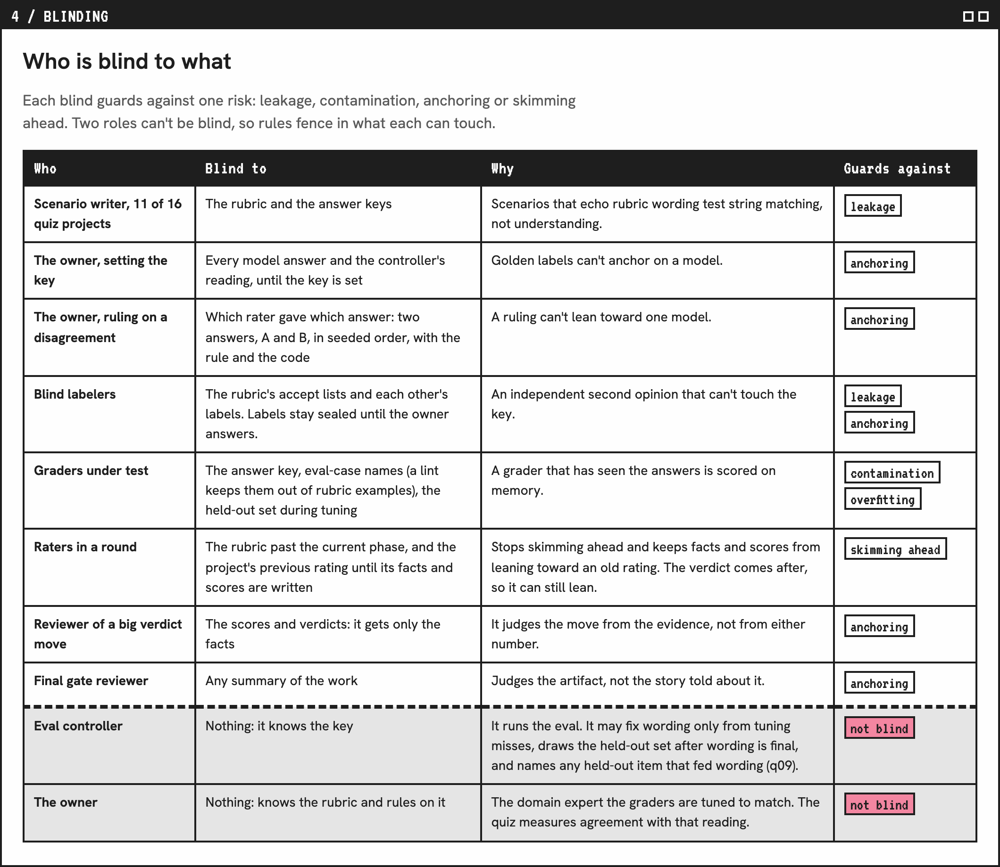

# Jevaluate System

This folder holds the source of the system page. GitHub shows an HTML file as code, so the images below are screenshots of the live page: **[tiffygk.github.io/jev-mode/system](https://tiffygk.github.io/jev-mode/system/)**.

Jevaluate rates how well open-source projects use Jev. Its raters work like LLM annotators, and the rubric is their codebook. A rater reports only what it sees in a project's code, each fact citing a file and line, and code derives the rest. Routing, which sorts a project by what its code does with Jev's answers, gets the strictest scripts, which refuse an answer that breaks a rule.

## How the skills fit

- [Jevaluate](../jevaluate/) rates one project: 23 facts, four scores, and a verdict the rater picks and code caps, never an average.
- [Jevaluate Eval](../jevaluate-eval/) tests whether graders apply the rubric correctly before a rubric change reaches any rating. In the 2026-09-30 run, graders got 33 of 33 [quiz answers](../jevaluate-eval/results/2026-09-30-quiz.md) right and routed all 19 [test projects](../jevaluate-eval/results/2026-09-30-baseline.md) (17 real, 2 written for the eval) correctly in 3 of 3 runs.
- [Jevaluate Harness](../jevaluate-harness/) runs Jevaluate over many projects in one round, guides rubric changes and publishes ratings, with scripts checking each step.

## Building with Jev

Start with [Jev Sources](../jev-sources/). It loads the TypeSafe doc, cookbook and blog sections matching your question into your coding agent's context. Each is tagged reference rule, cookbook example or vendor claim, so the model can quote TypeSafe instead of building Jev from memory. Its hooks remind the model to read first. In Claude Code they also turn back a helper agent's Jev task that doesn't say to read the sources.

## Jevaluate System Process

Each image is one part of the [live page](https://tiffygk.github.io/jev-mode/system/).

### 1. The five design rules

The rules every other part follows. Start with "Code enforces, text explains": each rubric rule names the function that refuses a wrong answer.

<a href="https://tiffygk.github.io/jev-mode/system/#rules-h"><picture><source media="(prefers-color-scheme: dark)" srcset="images/design-rules-dark.png"></picture></a>

### 2. How the pieces fit

The three workflows the harness runs: testing a rubric change, a rating round, and publishing. Follow a rubric change through the eval to the git tag that freezes it.

<a href="https://tiffygk.github.io/jev-mode/system/#d1-h"><picture><source media="(prefers-color-scheme: dark)" srcset="images/components-dark.png"></picture></a>

### 3. How a project is routed

How a project is sorted before it's rated. Each script window marks where code refuses a wrong answer or fills in a value the rater never enters.

<a href="https://tiffygk.github.io/jev-mode/system/#d2-h"><picture><source media="(prefers-color-scheme: dark)" srcset="images/routing-dark.png"></picture></a>

### 4. The eval every rubric version passes

The checks a rubric change passes, in order, before it's frozen. Pass bars are set before the run, and each rule is scored on its own.

<a href="https://tiffygk.github.io/jev-mode/system/#d3-h"><picture><source media="(prefers-color-scheme: dark)" srcset="images/eval-pipeline-dark.png"></picture></a>

### 5. Who is blind to what

Who can't see what during an eval or a rating. Each row names the risk its blind guards against; the last two rows are the roles that can't be blind.

<a href="https://tiffygk.github.io/jev-mode/system/#d4-h"><picture><source media="(prefers-color-scheme: dark)" srcset="images/blinding-dark.png"></picture></a>
